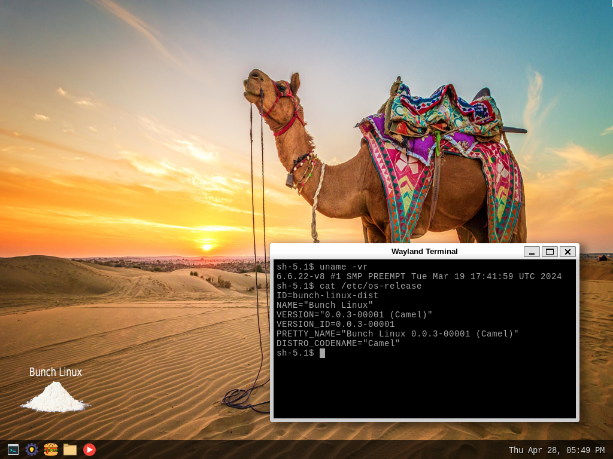

## Welcome to Open Bunch Linux OS [in development]
[Project started on 28-Aug-2022]<br><br>

The aim is to fully understand the foundations of systems and applications starting from the lowest possible level. The idea is to create a fully working alternative to Raspbian OS and have fun! <br>
To get an overview about current and future state refer to the [CHANGELOG.md](https://github.com/waelkarman/bunch-linux-manifests/blob/main/CHANGELOG.md) .
<br>



- Linux kernel 6.12.y
- Yocto 6.0 ~ Wrynose (LTS)
- C
- C++/17
- Qt6/QML
- Python3
- Cmake
- SQLite3
- Bash scripts
- GTK+3
- POSIX thread
- Kernel drivers
- Rauc Update
- GStreamer
- ZeroMQ

Bunch Linux combines more repositories such as:<br>
Apps ~
- [burger-app](https://github.com/waelkarman/burger-shop) (C++\17, Qt6/QML, SQLite3)
- [sensors-app](https://github.com/waelkarman/sensors-app) (C++\17, Qt6/QML)
- [open-pipe-media-player](https://github.com/waelkarman/open-pipe-media-player) (C, GStreamer, GTK+3) 
- [button-service](https://github.com/waelkarman/button-service) (C++/17)
- [networkchecker-service](https://github.com/waelkarman/networkchecker-service) (Python3)
- [auto-update-service](https://github.com/waelkarman/bunch-linux-manifests/blob/main/meta-bunch-linux%2Frecipes-core%2Fbunch-update%2Fbunch-update%2Fbunch-update.sh) (Bash Script)

Kernel ~
- [linux-rpi-kernel](https://github.com/waelkarman/linux-rpi-kernel) (C)
- [custom-kernel-modules](https://github.com/waelkarman/kernel-modules) (C)
- [active-buzzer-kernel-driver](https://github.com/waelkarman/linux-rpi-kernel/tree/rpi-6.12.y/drivers/platform/bunch_linux/active_buzzer) (C)
- [active-buzzer-devicetree](https://github.com/waelkarman/linux-rpi-kernel/blob/rpi-6.12.y/arch/arm/boot/dts/overlays/bcm2711-rpi-4-b-active-buzzer-overlay.dts) (dts overlay)
- [passive-buzzer-kernel-driver](https://github.com/waelkarman/linux-rpi-kernel/tree/rpi-6.12.y/drivers/platform/bunch_linux/passive_buzzer) (C)
- [passive-buzzer-devicetree](https://github.com/waelkarman/linux-rpi-kernel/blob/rpi-6.12.y/arch/arm/boot/dts/overlays/bcm2711-rpi-4-b-passive-buzzer-overlay.dts) (dts overlay)

System configuration and boot sequence deeply documented at:<br>

- [bunch-linux-boot-sequence](https://github.com/waelkarman/bunch-linux-boot-sequence) (dts, kconfig)

# Build and run
Requirements: a Linux host supported by Yocto 6.0 (e.g. Ubuntu 24.04/26.04, Debian 12/13) with ~150 GB free disk.

```sh
scripts/gen-secrets.sh      # once: RAUC CA + signing key, hotspot passphrase (secrets/, git-ignored)
./build.sh                  # kas checkout + kas build of the RAUC bundle and the SD card image
./build.sh shell            # bitbake shell in the build environment
```

Outputs are in `build/tmp/deploy/images/bunch-linux-machine/` (`*.wic` for the SD card, `*.raucb` for updates).

Configuration lives in `kas/bunch-linux-demo.yml`. Notable switches:
- `BUNCH_WLAN_MODE`: `"ap"` (hotspot routed through WireGuard, optional `secrets/wg0.conf`) or `"client"` (needs `secrets/wpa_supplicant-wlan0.conf`).
- `BUNCH_DEBUG_MODE` / `BUNCH_PRODUCTION_MODE`: debug builds allow root login without password; production builds do not.

Secrets (signing keys, Wi-Fi and VPN credentials) are never committed: see [secrets/README.md](secrets/README.md).
Optional development checkouts (kernel fork, boot docs): `kas checkout kas/bunch-linux-demo.yml:kas/dev-repos.yml`.

# Join and contribute
Contributing to a project like this can enhance your skills and elevate your awareness to a higher level. This project is rooted in the desire to thoroughly learn about systems and applications and more. Integrating applications into a customized and lightweight version of Linux provides a deeper understanding of the domain in which the applications are employed.<br>
To get started, introduce yourself in the appropriate [discussion](https://github.com/waelkarman/bunch-linux-manifests/discussions/1).

